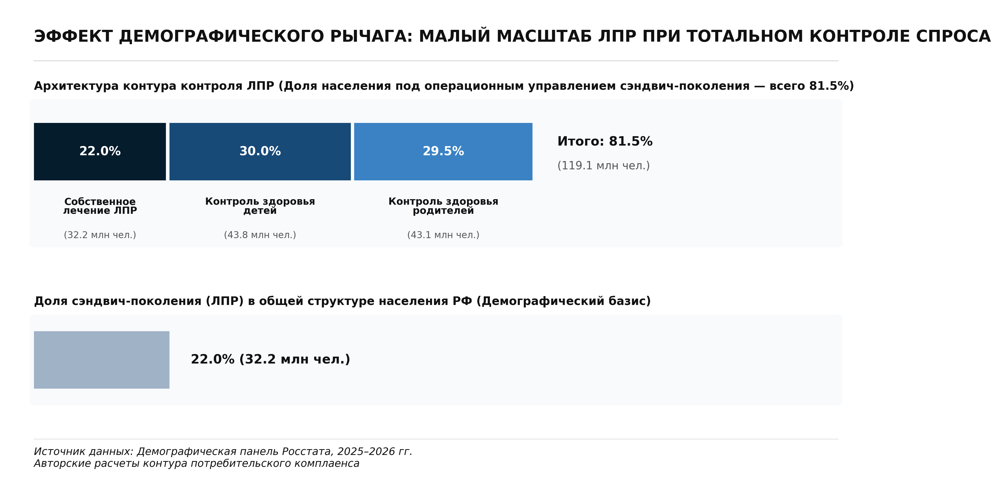
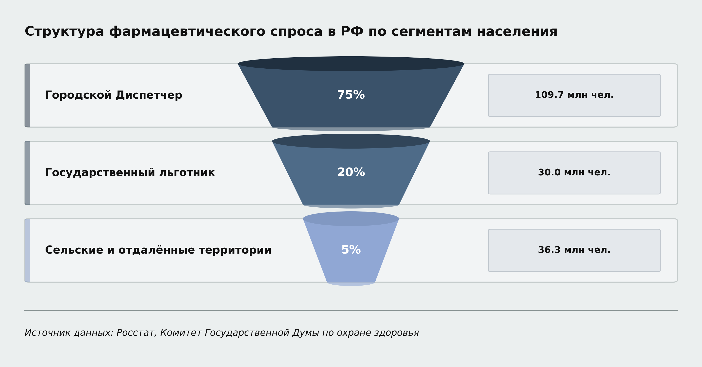

# Business & Commercial Analytics Visualizations (Python)

Коллекция аналитических визуализаций для презентации коммерческих результатов, анализа рычагов роста и воронки продаж в фармацевтике.

## 📊 Визуализации

* **Анализ рычагов роста (McKinsey Lever Chart)**: драйверы выручки и маржинальности ([код](chart_3_mckinsey_lever_top.ipynb)).  
  

* **Коммерческая воронка продаж в фарме**: анализ конверсии с экспортом в PNG ([код](pharma_funnel_visible_source_png.ipynb)).  
  

## 💻 Стек
Python (pandas, matplotlib, seaborn, Jupyter / Google Colab).
